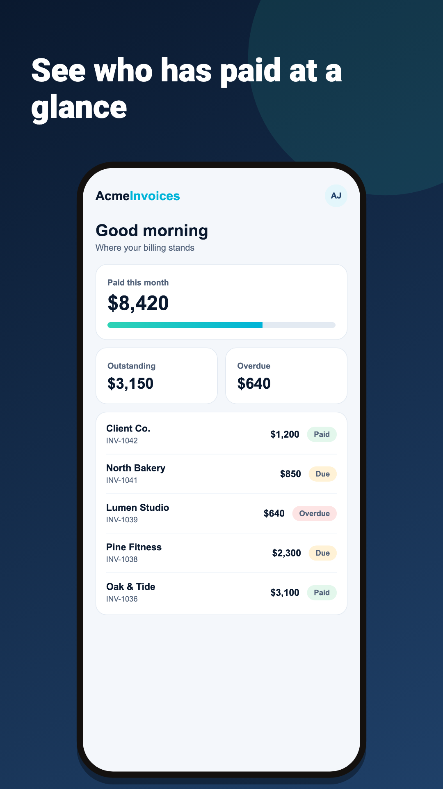
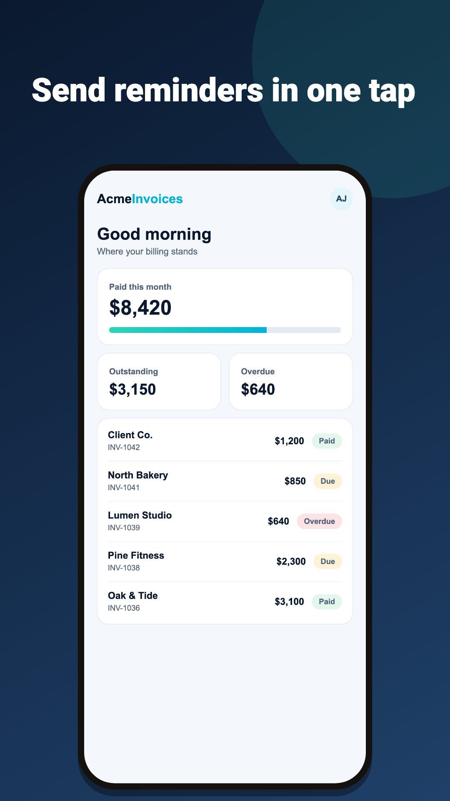

# store-pack

**A Claude skill that gets an app Play Store and App Store ready: icons, framed screenshots in the exact store sizes, a feature graphic, listing text with the limits enforced, and a checklist of the blockers that get apps rejected.**

Ask an agent to "make my app Play Store ready" and it produces a `store/` folder you can upload from:

```
store/
  google-play/metadata/android/<locale>/   title, short and full description, release notes, images/
  app-store/metadata/en-US/                name, subtitle, promo text, keywords, description, URLs
  app-store/screenshots/en-US/             iPhone 6.9", 6.5" and iPad 13" sets
  README.md                                the blockers table, first
```

<p align="center">
  
  
</p>
<p align="center"><sub>Made by <code>scripts/make_pack.py</code> from one raw screenshot and a JSON file. The app is fictional.</sub></p>

## What it does

- **Frames your screenshots** on a brand gradient with a caption, at the exact sizes both stores require (RGB PNG with no alpha, which both stores reject otherwise).
- **Builds the feature graphic and icons** from your art, including every iOS icon size.
- **Writes listing text** in the fastlane layout and refuses anything over a store's character limit.
- **Checks every image** against the published rules (size, count, alpha, file size).
- **Lists blockers** that cause rejections: account deletion, Sign in with Apple, test ad IDs, payments outside store billing, permissions that need a declaration, reviewer access, the 12-tester rule for new Play accounts, data-safety traps and more.
- **Never submits, commits or deploys.** You do that.

## Install

The skill is a folder. Put it where your agent loads skills.

**Claude Code**

```bash
git clone https://github.com/nowfalsalahudeen/store-pack ~/.claude/skills/store-pack
```

(for one project only, clone into `<project>/.claude/skills/store-pack`).

**Other agents:** copy `SKILL.md`, `scripts/`, `templates/` and `docs/` into the folder your agent reads skills from.

**Requirements:** Python 3, the Flutter SDK (the composer is a Flutter test, so no Flutter app is needed), and macOS for the image checks and icon resizing (`sips`). The first run does `flutter pub get` inside `scripts/compose`.

## Use

Ask in plain words:

> "Make my app Play Store ready. Here are the screenshots."

> "Write the Play and App Store listings for my app and check the limits."

> "What would get this app rejected?"

The agent reads your app for the facts (package id, permissions, SDKs, how accounts and payments work), then runs the steps below. Full tutorial: [docs/getting-started.md](docs/getting-started.md).

### Run it yourself

```bash
cp -R examples/store my-app-store && cd my-app-store      # start from the working example
python3 ../scripts/make_pack.py app.json                  # screenshots, icons, feature graphic, then checks
python3 ../scripts/write_listings.py listings.json        # listing text with limits enforced
python3 ../scripts/check_pack.py app.json                 # re-run the checks any time
```

Every option is in [docs/config-reference.md](docs/config-reference.md).

## What is in the box

```
SKILL.md                      workflow, store specs, blockers checklist (entry point)
scripts/
  make_pack.py                runs the whole pack from app.json
  compose/                    the Flutter image composer (framed screenshots, feature graphic, icon)
  build_icons.py              every icon size the stores need
  check_pack.py               validates images against the store rules
  write_listings.py           listing text files, limits enforced
templates/                    app.example.json, listings.example.json
examples/store/               a complete worked example (fictional app) and its output
docs/                         getting started, config reference, how it works
```

## Honesty

Store specifications change. The skill points to the consoles as the source of truth and says so; confirm sizes and limits there before submitting.

## Author

Built by **Nowfal** from real store submissions. Portfolio: [nowfal.in](https://nowfal.in).

## Licence

MIT. See [LICENSE](LICENSE).
